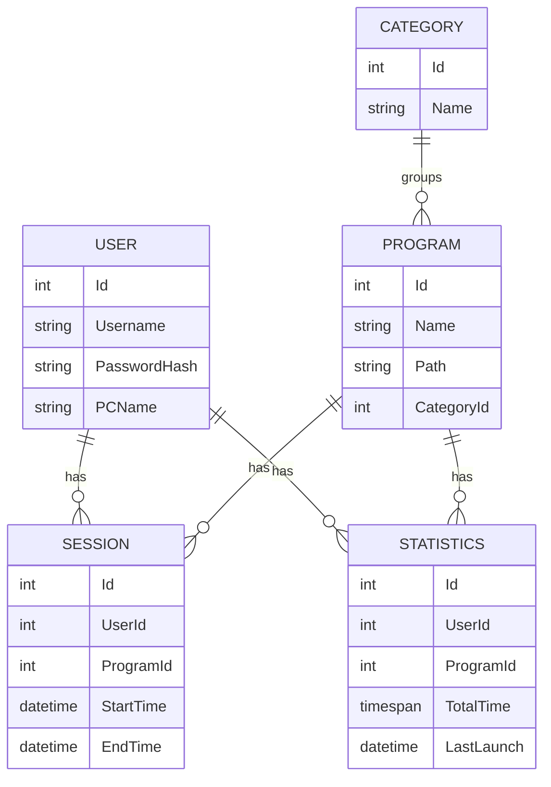

# Katastata

**Katastata** — настольное приложение для Windows, которое отслеживает, сколько времени вы проводите в программах на компьютере. Оно само находит запущенные программы с окнами, записывает каждую сессию (когда открыли, когда закрыли, сколько проработали), считает общее время и показывает всё в виде удобной статистики. Отчёт можно выгрузить в Excel или Word.


> Скриншоты: добавьте в папку `docs/screenshots/` и подключите ниже.
>
> ``

---

## Содержание

- [Возможности](#возможности)
- [Технологии](#технологии)
- [Как это работает](#как-это-работает)
- [Архитектура](#архитектура)
- [Модель данных](#модель-данных)
- [Установка и запуск](#установка-и-запуск)
- [Как пользоваться](#как-пользоваться)
- [Где хранятся данные](#где-хранятся-данные)
- [Безопасность](#безопасность)
- [Ограничения](#ограничения)
- [Планы развития](#планы-развития)
- [Автор и лицензия](#автор-и-лицензия)

---

## Возможности

- **Автоматический учёт времени.** Приложение раз в 10 секунд проверяет запущенные процессы и ведёт сессии без участия пользователя.
- **История сессий.** Для каждой сессии сохраняются программа, время запуска, время закрытия и длительность.
- **Общая статистика.** По каждой программе считается суммарное время и дата последнего запуска.
- **Несколько пользователей.** Регистрация и вход по логину и паролю; сессии и статистика у каждого пользователя свои.
- **Категории программ.** Программы можно раскладывать по категориям (например, «Учёба», «Игры», «Работа»), создавать и удалять свои категории.
- **Плитки программ.** Главное окно показывает программы плитками с иконками, взятыми из самих `.exe`. Есть фильтр по категории и сортировка по имени и по дате последнего запуска.
- **Карточка программы.** Полная история сессий, общее время, путь к файлу, переименование программы и смена категории.
- **Поиск.** Фильтры по названию программы и категории в окнах «Сессии» и «Статистика».
- **Экспорт отчёта** в Excel (`.xlsx`, время в часах числом, его можно суммировать) и Word (`.docx`, таблица).
- **Светлая и тёмная темы.**
- **Работа в трее.** Закрытие окна сворачивает приложение в трей, и мониторинг продолжается.
- **Журнал ошибок.** Ошибки мониторинга пишутся в файл `error.log`, приложение не падает.

## Технологии

| Область | Что используется |
|---|---|
| Язык и платформа | C#, .NET 8 (`net8.0-windows`) |
| Интерфейс | WPF (XAML), Windows Forms (только иконка в трее) |
| Паттерн | MVVM (`INotifyPropertyChanged`, `RelayCommand`) |
| База данных | SQLite через Entity Framework Core 9 |
| Экспорт | DocumentFormat.OpenXml 3.3 |
| Прочее | Extended.Wpf.Toolkit, System.Drawing.Common (извлечение иконок) |
| Подключена, но пока не используется | OxyPlot.Wpf (задел под графики) |

## Как это работает

Мониторинг устроен в классе `AppMonitorService`.

1. Запускается таймер с периодом 10 секунд.
2. На каждом тике собирается список процессов, у которых есть **главное окно с заголовком**. Фоновые службы в учёт не попадают.
3. Новый процесс открывает сессию. Путь к `.exe` определяет программу, и если её ещё нет в базе, она добавляется в категорию «Не классифицировано».
4. Если процесс исчез, сессия закрывается временем, когда его видели в последний раз.
5. Сессия и обновление общей статистики сохраняются **одним вызовом `SaveChanges`**, то есть в одной транзакции.
6. При выходе из приложения все ещё запущенные программы дописываются до текущего момента.

Что учтено в логике:

- **Сессии короче 1 минуты не сохраняются.** Так случайные запуски не засоряют историю.
- **Защита от повторного использования PID.** Сессия привязана ещё и ко времени старта процесса, поэтому новая программа с тем же PID не продолжит чужую сессию.
- **Нет двойного учёта при перезапуске.** Если программа была открыта до старта Katastata, время считается с момента старта мониторинга.
- **Процессы без доступа игнорируются** (например, запущенные от администратора), без ошибок и без повторных попыток на каждом тике.
- **Тики не накладываются друг на друга.** Если прошлая проверка ещё идёт, новая пропускается.
- **У каждой операции свой `DbContext`.** Контекст EF Core не потокобезопасен, а таймер и интерфейс работают в разных потоках.

## Архитектура

Проект построен по MVVM: модели отделены от логики, логика отделена от окон.

```
Katastata/
├── Models/            # Сущности БД: User, Program, Session, Statistics, Category
├── Data/
│   └── AppDbContext.cs        # Контекст EF Core, связи, начальная категория
├── Services/
│   └── AppMonitorService.cs   # Мониторинг, запросы к БД, экспорт в Excel и Word
├── ViewModels/        # MainViewModel, UserViewModel, SettingsViewModel,
│                      # StatisticsViewModel, SessionsViewModel, ProgramDetailsViewModel, ...
├── UserControls/      # LoginPage, RegisterPage
├── Helpers/           # PasswordHelper, AppPaths, конвертеры для XAML
├── Assets/
│   ├── Themes/        # Light.xaml, Dark.xaml
│   ├── Icons/         # Иконка по умолчанию
│   └── Logo/          # Логотипы
├── *.xaml / *.xaml.cs # Окна: Auth, Main, Sessions, Statistics, ProgramDetails,
│                      # Settings, Export, About
└── App.xaml(.cs)      # Точка входа: создание БД, вход, запуск главного окна
```

Поток запуска: `App` создаёт базу, если её нет, затем показывает `AuthWindow`. После успешного входа открывается `MainWindow` с `MainViewModel`, и в этот момент стартует мониторинг.

## Модель данных



Список программ и категорий общий для всех пользователей компьютера, а сессии и статистика у каждого пользователя свои. Категория с `Id = 1` («Не классифицировано») создаётся автоматически, и удалить её нельзя. Категорию, в которой есть программы, тоже удалить нельзя. При удалении аккаунта вместе с ним удаляются его сессии и статистика.

## Установка и запуск

### Требования

- Windows 10 или 11
- [.NET 8 SDK](https://dotnet.microsoft.com/download/dotnet/8.0)
- Visual Studio 2022 или JetBrains Rider (по желанию)

### Из командной строки

```bash
git clone https://github.com/schtengel/Katastata.git
cd Katastata
git checkout develop
dotnet run --project Katastata
```

### Из Visual Studio

1. Откройте `Katastata.sln`.
2. Выберите проект `Katastata` как запускаемый.
3. Нажмите `F5`.

Пакеты NuGet восстановятся автоматически, база данных создаётся при первом запуске.

## Как пользоваться

1. **Войдите или зарегистрируйтесь.** Логин не короче 3 символов, пароль не короче 5.
2. **Нажмите «Обновить»**, чтобы найти запущенные программы. Дальше они добавляются сами.
3. **Откройте плитку программы**, чтобы увидеть историю сессий, общее время и последний запуск. Здесь же можно переименовать программу и сменить категорию.
4. **Кнопки на верхней панели:** сортировка по имени, сортировка по дате запуска, сессии, настройки, справка, переключение темы.
5. **В настройках** можно создать или удалить категорию, открыть общую статистику и список сессий, выгрузить отчёт и удалить аккаунт.
6. **Закрытие окна** сворачивает Katastata в трей. Выйти полностью можно через меню значка в трее («Выход»).

## Где хранятся данные

| Что | Путь |
|---|---|
| База данных | `%LOCALAPPDATA%\Katastata\katastata.db` |
| Журнал ошибок | `%LOCALAPPDATA%\Katastata\error.log` |

Если рядом с программой лежит `katastata.db` от старой версии, при первом запуске она копируется в папку данных. Чтобы начать с чистого листа, закройте приложение и удалите папку `%LOCALAPPDATA%\Katastata`.

## Безопасность

- Пароли не хранятся в открытом виде. Используется **PBKDF2-SHA256**, 600 000 итераций и случайная соль 16 байт. Формат записи: `v2$итерации$соль$хэш`.
- Хэши сравниваются за постоянное время (`CryptographicOperations.FixedTimeEquals`), что защищает от атаки по времени ответа.
- Хэши старого формата (SHA-256 без соли) принимаются при входе и **автоматически обновляются** до нового формата.
- Все данные лежат локально, приложение не отправляет ничего в сеть.

## Ограничения

- Только Windows, потому что используются WPF и системные процессы.
- Учитываются только программы с видимым главным окном. Службы и фоновые процессы не отслеживаются.
- Приложения, запущенные с правами администратора, недоступны для мониторинга, если Katastata запущена без этих прав.
- Время считается по факту работы процесса, а не по активному окну: свёрнутая или неактивная программа тоже накапливает время.
- Выбранная тема не запоминается между запусками.

## Автор и лицензия

Автор: [@schtengel](https://github.com/schtengel), Telegram: @EngelimFleisch

Проект распространяется по лицензии MIT. Текст лицензии нужно положить в файл `LICENSE` в корне репозитория.
